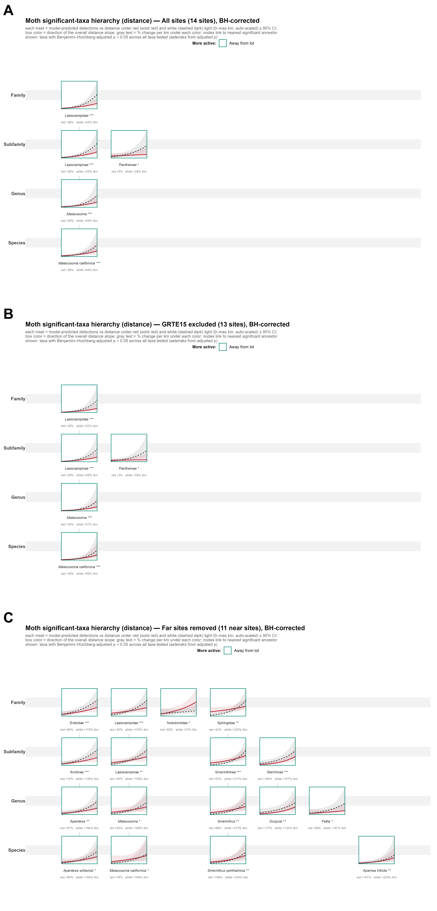
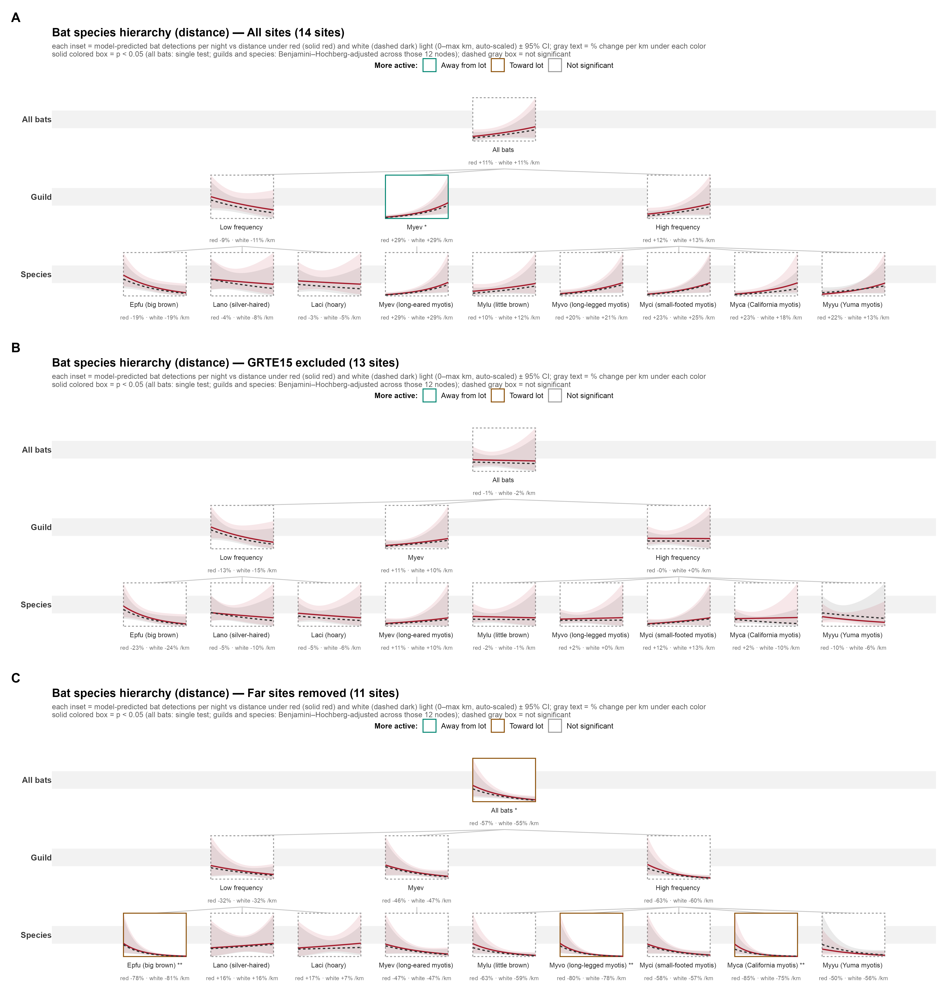
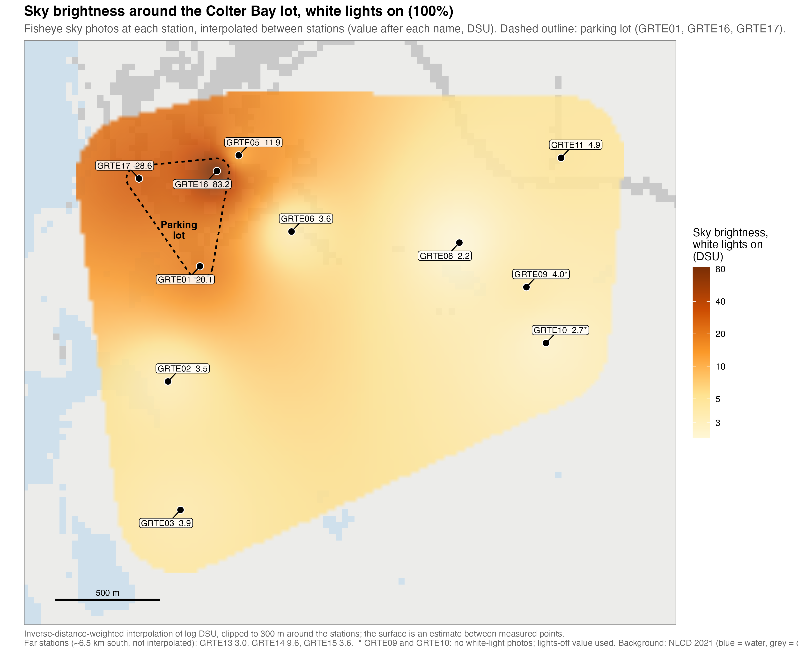

```{r setup, include=FALSE}
library(tidyverse)

bat_theme <- theme_classic(base_size = 15, base_family = "Arial") +
  theme(
    plot.background    = element_rect(fill = "white", color = NA),
    panel.background   = element_rect(fill = "white", color = NA),
    panel.grid.major.y = element_line(color = "#EBEBEB", linewidth = 0.4),
    panel.grid.major.x = element_blank(),
    axis.line          = element_line(color = "#444444", linewidth = 0.5),
    axis.ticks         = element_line(color = "#444444"),
    axis.text          = element_text(color = "#333333", size = 16),
    axis.title         = element_text(color = "#222222", size = 18),
    plot.title         = element_text(color = "#111111", size = 14,
                                      face = "bold", margin = margin(b = 3)),
    plot.subtitle      = element_text(color = "#666666", size = 10,
                                      margin = margin(b = 8)),
    legend.background  = element_rect(fill = "white", color = NA),
    legend.key         = element_rect(fill = "white", color = NA),
    legend.text        = element_text(color = "#333333", size = 10),
    legend.title       = element_text(color = "#444444", size = 9, face = "bold"),
    strip.background   = element_rect(fill = "#F2F2F2", color = NA),
    strip.text         = element_text(color = "#222222", face = "bold", size = 10),
    plot.caption       = element_text(color = "#999999", size = 8,
                                      hjust = 0, margin = margin(t = 8)),
    plot.margin        = margin(12, 14, 10, 12)
  )

col_red    <- "#7A1C2E"   
col_white  <- "#C9A84C"   
col_navy   <- "#1B2A4A"   
col_purple <- "#4A1259"   
col_ivory  <- "#F5F0E3"   

intensity_pal <- c("10"  = col_ivory,
                   "30"  = col_white,
                   "50"  = col_purple,
                   "70"  = col_red,
                   "100" = col_navy)
```

## Data Pipeline

```{r import, warning=FALSE, message=TRUE}
source("R/01_import_sonobat.R")
```

```{r clean, warning=FALSE, message=FALSE}
source("R/02_clean_data.R")
data <- clean_data(data_raw)
```

```{r habitat, warning=FALSE, message=FALSE}
source("R/03_extract_habitat.R")

data_env <- add_habitat(
  data,
  forest_raster = nlcd_forest,
  buffer = 50
)

data_env <- add_moonlight(data_env)
```

```{r treatment, warning=FALSE, message=FALSE}
source("R/07_add_light_treatment.R")

data_env <- data_env %>%
  left_join(
    lighting %>% select(date, color, intensity),
    by = "date"
  ) %>%
  mutate(
    color     = factor(color),
    site      = factor(site),
    intensity = factor(intensity)
  )

```

```{r distance, warning=FALSE, message=FALSE}
library(sf)

ref_point <- st_as_sf(
  data.frame(lon = -110.645134, lat = 43.904879),
  coords = c("lon", "lat"),
  crs = 4326
)

sites_sf <- st_as_sf(sites, coords = c("lon", "lat"), crs = 4326)
sites_sf <- st_transform(sites_sf, 32612)
ref_point <- st_transform(ref_point, 32612)

sites_sf$dist_m <- as.numeric(st_distance(sites_sf, ref_point))

# Pull only dist_m 
site_dists <- as.data.frame(sites_sf) %>% dplyr::select(site, dist_m)

data_env <- data_env %>%
  left_join(site_dists, by = "site") %>%
  mutate(
    dist_km = dist_m / 1000,
    dist_cat = case_when(
      dist_km < 0.52 ~ "Close",
      dist_km < 1    ~ "Medium",
      dist_km < 2.1  ~ "Further",
      TRUE           ~ "Far"
    ),
    jd_c = jd - mean(jd, na.rm = TRUE)   # centered Julian day
  )

data_env <- data_env %>% filter(!is.na(dist_km))

data_env %>% select(site, dist_km) %>% distinct() %>% arrange(dist_km)

# Reclassify out-of-region misidentifications onto the correct regional species,
# INCLUDING inside compound labels: Labo (Eastern red bat) -> Mylu and Myse
# (N. long-eared) -> Myev. Token-wise replacement; duplicate candidates
# that result are collapsed while preserving vote order, so e.g. "Mylu/Labo" ->
# "Mylu" (becomes a single-species call) and "Lano/Myse/Mylu" -> "Lano/Myev/Mylu".
.fix_aliases <- function(x) {
  vapply(stringr::str_split(x, "/"), function(toks) {
    toks <- dplyr::recode(toks, Labo = "Mylu", Myse = "Myev")
    paste(toks[!duplicated(toks)], collapse = "/")
  }, character(1))
}
data_env <- data_env %>% mutate(species = .fix_aliases(species))

# Merging can put two rows on the same species at the same site/date/recording;
# sum detections so counts stay additive and re-derive mean confidence.
.recode_key <- c("site", "year", "date", "jd", "jd2", "species",
                 "datetime", "time_sec")
data_env <- data_env %>%
  group_by(across(all_of(.recode_key))) %>%
  summarise(detections          = sum(detections),
            weighted_detections = sum(weighted_detections),
            across(-c(detections, weighted_detections, mean_confidence), first),
            .groups = "drop") %>%
  mutate(mean_confidence = weighted_detections / detections)

# Focal single-species set for the per-species and community models.
focal_spp <- c("Epfu", "Laci", "Lano", "Myca", "Myci",
               "Mylu", "Myvo", "Myyu", "Myev")

# Acoustic guilds by call frequency. 
lowfreq_spp  <- c("Epfu", "Lano", "Laci")                  # low frequency
medfreq_spp  <- c("Myev")                                  # medium frequency (Myev only)
highfreq_spp <- c("Mylu", "Myvo", "Myci", "Myca", "Myyu")  # high frequency
assign_cluster <- function(x) {
  vapply(stringr::str_split(x, "/"), function(toks) {
    if (all(toks %in% lowfreq_spp))       "LowFreq"
    else if (all(toks %in% medfreq_spp))  "Myev"
    else if (all(toks %in% highfreq_spp)) "HighFreq"
    else NA_character_
  }, character(1))
}

# Overall stream = focal single species + compounds that fall within ONE guild.
# Cross-guild compounds (e.g. Mylu/Myev, Anpa/Epfu) and non-focal singles are
# dropped, so the kept compounds match the guild definitions and the overall
# total equals the sum of the three guilds. Report what gets dropped.
.dropped <- data_env %>%
  filter(is.na(assign_cluster(species))) %>%
  mutate(kind = ifelse(str_detect(species, "/"),
                       "cross-guild compound", "non-focal single")) %>%
  group_by(kind) %>%
  summarise(labels = n_distinct(species), detections = sum(detections),
            .groups = "drop")
message("Dropped (not within a single guild): ",
        paste(sprintf("%s = %d detections (%d labels)",
                      .dropped$kind, .dropped$detections, .dropped$labels),
              collapse = " | "))

data_env <- data_env %>% filter(!is.na(assign_cluster(species)))

message("Overall data rows: ", nrow(data_env),
        "  |  single-species detections: ",
        sum(data_env$detections[!str_detect(data_env$species, "/")]),
        "  |  within-guild compound labels: ",
        n_distinct(data_env$species[str_detect(data_env$species, "/")]),
        " (", sum(data_env$detections[str_detect(data_env$species, "/")]),
        " detections)")
```

Site sky brightness (`brightness_dark`, used in all models) is the **darkest** of each site's lights-off sky photos (minimum per-image mean DSU), so transient light in a single frame (e.g. headlights) cannot raise it; the 3-photo average is kept as `brightness_dark_mean`. Built by `python/run_sky_brightness.py`.

```{r sky_brightness, warning=FALSE, message=TRUE}
source("R/09_add_sky_brightness.R")
```

```{r bat_traits, warning=FALSE, message=FALSE}
library(readxl)

bat_traits <- read_excel("data/bat_traits.xlsx") %>%
  rename(species = Species)

data_env <- data_env %>%
  left_join(bat_traits, by = "species")

# Single-species subset for the per-species and community models. Compound
# (multi-species) labels are excluded here but remain in `data_env` for the
# overall model and figures.
data_env_focal <- data_env %>% filter(species %in% focal_spp)

# Per-site-night totals: bat activity = sum of detections across every species /
# compound label on a site-night. The site-night is the unit the light treatment
# is applied to.
# Every covariate is constant within a site-night, so nothing is lost aggregating.
site_night <- data_env %>%
  group_by(site, date) %>%
  summarise(
    total_det       = sum(detections, na.rm = TRUE),
    color           = first(color),
    intensity       = first(intensity),
    dist_km         = first(dist_km),
    mean_phase      = first(mean_phase),
    pct_nonforest   = first(pct_nonforest),
    brightness_dark = first(brightness_dark),
    jd              = first(jd),
    jd_c            = first(jd_c),
    .groups = "drop"
  )
```

## Species Detection Counts

```{r species_counts, warning=FALSE, message=FALSE, fig.width=8, fig.height=5}
# Total detections per species (compound multi-species labels pooled into one bar)
spp_counts <- data_env %>%
  mutate(grp = ifelse(str_detect(species, "/"), "(compound)", species)) %>%
  group_by(grp) %>%
  summarise(detections = sum(detections), .groups = "drop") %>%
  mutate(grp = fct_reorder(grp, detections))

fig_spp_det <- ggplot(spp_counts, aes(detections, grp)) +
  geom_col(fill = col_navy, width = 0.75) +
  geom_text(aes(label = scales::comma(detections)),
            hjust = -0.1, size = 3.5, color = "#333333") +
  scale_x_continuous(expand = expansion(mult = c(0, 0.18)),
                     labels = scales::comma) +
  labs(title = "Total detections per species",
       subtitle = "SonoBat v30.1, Prob >= 0.9; compound (multi-species) labels pooled",
       x = "Total detections", y = NULL) +
  bat_theme

fig_spp_det

# Prevalence: how many of the sampled site-nights each focal species appears on
spp_prev <- data_env_focal %>%
  distinct(species, site, date) %>%
  count(species, name = "site_nights") %>%
  mutate(species = fct_reorder(species, site_nights))

fig_spp_prev <- ggplot(spp_prev, aes(site_nights, species)) +
  geom_col(fill = col_purple, width = 0.75) +
  geom_text(aes(label = site_nights), hjust = -0.15, size = 3.5, color = "#333333") +
  scale_x_continuous(expand = expansion(mult = c(0, 0.12))) +
  labs(title = "Site-nights each species was detected",
       subtitle = paste0("Out of ", n_distinct(paste(data_env$site, data_env$date)),
                         " sampled site-nights (focal species)"),
       x = "Site-nights with at least one detection", y = NULL) +
  bat_theme

fig_spp_prev

dir.create("output/figures", showWarnings = FALSE, recursive = TRUE)
ggsave("output/figures/species_counts.png", fig_spp_det,
       width = 8, height = 5, dpi = 200, bg = "white")
ggsave("output/figures/species_prevalence.png", fig_spp_prev,
       width = 8, height = 5, dpi = 200, bg = "white")
```

## Models

### Overall activity model (total detections per night)

```{r simple_model, warning=FALSE, message=FALSE}
library(glmmTMB)

# Overall activity model at the site-night level (one row per site x night).
# Total detections per night ~ treatment + covariates, with a site random effect.
# color x distance: lets the distance gradient differ between red and white light
# (the same term as the storyboard figures, so the main analysis and storyboards share one model).
# No ziformula: nightly totals have no structural zeros.
simple_model1 <- glmmTMB(
  total_det ~
    color * intensity +
    dist_km * intensity +
    color*dist_km +
    mean_phase +
    pct_nonforest +
    brightness_dark +
    jd_c + I(jd_c^2) +
    (1 | site),
  data   = site_night,
  family = nbinom2()
)

summary(simple_model1)
```

## Guild-cluster models

Rather than forcing ambiguous compound calls onto a single species, group every detection into the acoustic guild by call frequency: **low** (Epfu / Lano / Laci), **medium** (Myev), and **high** (Mylu / Myvo / Myci / Myca / Myyu). The medium-frequency guild is a single species, so it is labeled **Myev**. A detection joins a guild only if *every* candidate species in its label belongs to that guild. `data_env` holds only within-guild labels and the three guilds sum to the overall total. This models activity at the level SonoBat can actually resolve and it separates guilds that respond to distance differently (low-frequency activity concentrates near the lit parking lot, while the medium- and high-frequency guilds are more active farther out), which a pooled total would cancel out.

```{r cluster_setup, warning=FALSE, message=FALSE}
# `assign_cluster` and the guild sets (lowfreq_spp / medfreq_spp / highfreq_spp)
# are defined in the data pipeline above, where data_env was already restricted
# to within-guild labels -- so every row here assigns to a guild.
cl_det <- data_env %>%
  mutate(cluster = assign_cluster(species)) %>%
  group_by(site, date, cluster) %>%
  summarise(detections = sum(detections), .groups = "drop")

# zero-filled: every sampled site-night x guild, carrying site-night covariates
cluster_night <- site_night %>%
  select(site, date, color, intensity, dist_km, mean_phase,
         pct_nonforest, brightness_dark, jd_c) %>%
  tidyr::crossing(cluster = c("LowFreq", "Myev", "HighFreq")) %>%
  left_join(cl_det, by = c("site", "date", "cluster")) %>%
  mutate(detections = tidyr::replace_na(detections, 0),
         site = factor(site),
         cluster = factor(cluster, levels = c("LowFreq", "Myev", "HighFreq")))

# guild x color x intensity, plus a guild-specific distance slope
cluster_glmm <- glmmTMB(
  detections ~ color * intensity + cluster * dist_km + color +
    mean_phase + pct_nonforest + brightness_dark + jd_c + I(jd_c^2) +
    (1 | site),
  data      = cluster_night,
  ziformula = ~1,
  family    = nbinom2()
)

summary(cluster_glmm)

# guild-specific distance slopes (log scale)
emmeans::emtrends(cluster_glmm, ~ cluster, var = "dist_km")
```

### Data-integrity sanity checks

Assert the core invariants of the bat data pipeline before interpreting any model. These fail loudly (`stopifnot`) if the data being processed is not what the analysis assumes — e.g. an out-of-region alias slipped through, a guild set changed, a zero-fill grid is the wrong size, or a join dropped/duplicated site-nights.

```{r sanity_checks_bats, warning=FALSE, message=TRUE}
.n_sn  <- nrow(dplyr::distinct(data_env, site, date))
.toks  <- unlist(strsplit(unique(as.character(data_env$species)), "/"))

stopifnot(
  # focal set & guild partition
  "focal_spp should be 9 species"                 = length(focal_spp) == 9,
  "Myth must not be in focal_spp"                 = !("Myth" %in% focal_spp),
  "guild sets must be disjoint"                    = length(intersect(lowfreq_spp, c(medfreq_spp, highfreq_spp))) == 0 &&
                                                       length(intersect(medfreq_spp, highfreq_spp)) == 0,
  "guild sets must partition focal_spp"            = setequal(c(lowfreq_spp, medfreq_spp, highfreq_spp), focal_spp),
  "medium-frequency guild is Myev only"           = identical(sort(medfreq_spp), "Myev"),

  # alias reclassification removed out-of-region tokens (Labo->Mylu, Myse->Myev)
  "Labo should be reclassified away"              = !("Labo" %in% .toks),
  "Myse should be reclassified away"              = !("Myse" %in% .toks),

  # every retained label maps to exactly one guild (cluster filter worked)
  "every data_env label maps to a guild"          = all(!is.na(assign_cluster(data_env$species))),

  # distance & treatment sanity
  "distances are non-negative"                    = all(data_env$dist_km >= 0, na.rm = TRUE),
  "distances within plausible range (<= 8 km)"    = all(data_env$dist_km <= 8, na.rm = TRUE),
  "intensity has the 5 expected levels"           = setequal(levels(data_env$intensity), c("10","30","50","70","100")),
  "color is R/W"                                 = setequal(levels(data_env$color), c("R","W")),

  # site_night: one row per site-night, totals preserved, no missing covariates/treatment
  "site_night has one row per site-night"         = nrow(site_night) == .n_sn,
  "site_night preserves total detections"         = sum(site_night$total_det) == sum(data_env$detections),
  "site_night covariates complete"                = all(!is.na(dplyr::select(site_night, dist_km, mean_phase, pct_nonforest, brightness_dark))),
  "site_night treatment complete"                 = all(!is.na(site_night$color)) && all(!is.na(site_night$intensity)),

  # cluster_night: zero-filled site-night x 3 guilds, totals preserved
  "cluster_night is site-night x 3 guilds"        = nrow(cluster_night) == .n_sn * 3,
  "cluster_night has no NA detections"            = all(!is.na(cluster_night$detections)),
  "guild totals equal the overall total"          = sum(cluster_night$detections) == sum(data_env$detections),

  # spp_night: zero-filled site-night x focal species, focal totals preserved
  "spp_night is site-night x focal species"       = nrow(spp_night) == .n_sn * length(focal_spp),
  "spp_night has no NA detections"                = all(!is.na(spp_night$detections)),
  "spp_night preserves focal-species totals"      = sum(spp_night$detections) == sum(data_env_focal$detections)
)

message("Bat sanity checks passed: ", .n_sn, " site-nights across ",
        dplyr::n_distinct(data_env$site), " sites; ", length(focal_spp),
        " focal species; 3 guilds; distance ",
        paste(round(range(data_env$dist_km, na.rm = TRUE), 2), collapse = "-"), " km.")
```

## Community Analysis

```{r community, warning=FALSE, message=FALSE}
source("R/10_community_analysis.R")
community <- run_community_analysis(data_env_focal, bat_theme, col_red, col_white)
```

```{r community_results, warning=FALSE, message=FALSE}
# NMDS stress
cat("NMDS stress:", round(community$nmds$stress, 3), "\n")

# PERMANOVA
community$perm

# Homogeneity of dispersion (by color)
community$disp_test

# dbRDA — global and marginal tests
community$db_global
community$db_margin

# mvabund — multivariate GLM
community$mv_anova
```

## Moth (Insect) Data Import

```{r insect_import, warning=FALSE, message=FALSE}
source("R/13_import_insects.R")
insects <- import_insects("data/grte_distance_insectID.xlsx")
```

```{r insect_env, warning=FALSE, message=FALSE}
insect_events <- insects$total %>%
  left_join(sites, by = "site") %>%
  left_join(site_dists, by = "site") %>%
  mutate(
    dist_km  = dist_m / 1000,
    dist_cat = case_when(
      dist_km < 0.52 ~ "Close",
      dist_km < 1    ~ "Medium",
      dist_km < 2.1  ~ "Further",
      TRUE           ~ "Far"
    ),
    jd = lubridate::yday(date)
  ) %>%
  filter(!is.na(dist_km))

insect_events <- add_habitat(insect_events, forest_raster = nlcd_forest, buffer = 50,
                              cache_path = "data/insect_data_out.rds")

# Entries are dated but not exactly timestamped; noon avoids any timezone date-rollover
insect_events$datetime <- as.POSIXct(paste(insect_events$date, "12:00:00"), tz = "America/Denver")
insect_events <- add_moonlight(insect_events)

sky <- read_csv("data/sky_brightness_measurements.csv", show_col_types = FALSE) %>%
  mutate(site = toupper(site))
insect_events <- insect_events %>%
  left_join(sky %>% select(site, brightness_dark), by = "site")

insect_total_env <- insect_events %>%
  mutate(
    jd_c      = jd - mean(jd, na.rm = TRUE),
    color     = factor(color),
    site      = factor(site),
    intensity = factor(intensity)
  )

message("Moth sampling events: ", nrow(insect_total_env),
        "  |  Sites: ", n_distinct(insect_total_env$site),
        "  |  Date range: ", paste(range(insect_total_env$date), collapse = " to "))
```

### Data-integrity sanity checks (moths)

Assert the moth data is what the models assume before fitting. The moth unit is a sampling **event** (site $\times$ date $\times$ color $\times$ intensity); note one date has two events at a site, so there are slightly more events than unique site-dates.

```{r sanity_checks_moths, warning=FALSE, message=TRUE}
stopifnot(
  # one row per sampling event; counts are non-negative integers
  "insect_total_env is one row per event"   = nrow(insect_total_env) ==
                                                 dplyr::n_distinct(paste(insect_total_env$site, insect_total_env$date,
                                                                         insect_total_env$color, insect_total_env$intensity)),
  "moth detections are non-negative integers" = all(insect_total_env$detections >= 0) &&
                                                 all(insect_total_env$detections == floor(insect_total_env$detections)),

  # covariates present and in range
  "moth distances present and in range"     = all(!is.na(insect_total_env$dist_km)) &&
                                                 all(insect_total_env$dist_km >= 0 & insect_total_env$dist_km <= 8),
  "moth site-night covariates complete"     = all(!is.na(insect_total_env$mean_phase)) &&
                                                 all(!is.na(insect_total_env$pct_nonforest)) &&
                                                 all(!is.na(insect_total_env$brightness_dark)),

  # treatment factor levels
  "moth intensity has 5 expected levels"    = setequal(as.character(unique(insect_total_env$intensity)), c("10","30","50","70","100")),
  "moth color is R/W"                      = setequal(as.character(unique(insect_total_env$color)), c("R","W")),

  # taxonomic detection frames are consistent with the specimen table
  "family counts == specimens with family" = sum(insects$family$detections) == sum(!is.na(insects$specimens$Family)),
  "family detections positive integers"    = all(insects$family$detections >= 1) &&
                                                 all(insects$family$detections == floor(insects$family$detections)),
  "specimen table is non-empty"            = nrow(insects$specimens) > 0
)

message("Moth sanity checks passed: ", nrow(insect_total_env), " events across ",
        dplyr::n_distinct(insect_total_env$site), " sites; ",
        dplyr::n_distinct(insects$family$Family), " families; ",
        nrow(insects$specimens), " specimens.")
```

## Moth General Activity Model

```{r insect_general_model, warning=FALSE, message=FALSE}
source("R/15_insect_models.R")
insect_general <- run_insect_general_model(insect_total_env, bat_theme, intensity_pal)

summary(insect_general$model)
```

```{r insect_general_posthoc, warning=FALSE, message=FALSE}
cat("=== Color effect within each intensity level ===\n")
insect_general$em_color_intensity
pairs(insect_general$em_color_intensity, adjust = "holm")

cat("\n=== Distance slope by intensity level ===\n")
insect_general$em_dist_trend
```

```{r insect_general_figs, warning=FALSE, message=FALSE}
insect_general$fig_color_intensity
insect_general$fig_dist_intensity
```

## Moth Community Analysis (Family)

```{r insect_family_env, warning=FALSE, message=FALSE}
event_covariates <- insect_events %>%
  select(site, date, color, intensity, dist_km, dist_cat, jd,
         mean_phase, mean_moonlight, max_moonlight,
         pct_forest, pct_nonforest, brightness_dark)

insect_family_env <- insects$family %>%
  left_join(event_covariates, by = c("site", "date", "color", "intensity")) %>%
  filter(!is.na(dist_km)) %>%
  rename(species = Family) %>%
  mutate(color = factor(color), site = factor(site), intensity = factor(intensity))

message("Moth family-level rows: ", nrow(insect_family_env),
        "  |  Families: ", paste(sort(unique(insect_family_env$species)), collapse = ", "))
```

```{r insect_genus_species_distance, warning=FALSE, message=FALSE, fig.width=10, fig.height=6.5}
# Same across-distance predictions at subfamily, genus, and species resolution.
# Restrict to the 9 best-sampled taxa (>= 30 site-nights) at each level; for
# genus, drop labels that are really subfamily/family placeholders (-inae/-idae).
source("R/33_moth_taxonomy.R")   # add_species_bin()
sp_tax <- add_species_bin(insects$specimens)

make_taxon_distance <- function(level, out_tag, pretty,
                                exclude_rx = NULL, n_top = 9, min_sitenights = 30,
                                drop_sites = NULL) {
  sfx <- if (is.null(drop_sites)) "" else "_nofar"
  sub_note <- if (is.null(drop_sites))
    "Model-estimated marginal means ± 95% CI (negative-binomial GLMM)" else
    "Far sites (GRTE13/14/15) removed — marginal means ± 95% CI"
  sub_note_log <- if (is.null(drop_sites))
    "Model-estimated marginal means (log scale)" else
    "Far sites (GRTE13/14/15) removed — marginal means (log scale)"
  det <- sp_tax %>% filter(!is.na(.data[[level]])) %>% rename(taxon = all_of(level))
  if (!is.null(exclude_rx)) det <- det %>% filter(!str_detect(taxon, exclude_rx))
  keep <- det %>% group_by(taxon) %>%
    summarise(d = n(), sn = n_distinct(paste(site, date)), .groups = "drop") %>%
    filter(sn >= min_sitenights) %>% slice_max(d, n = n_top) %>% arrange(desc(d)) %>%
    pull(taxon)

  det_kept <- det %>% filter(taxon %in% keep) %>%
    group_by(site, date, color, intensity, taxon) %>%
    summarise(detections = n(), .groups = "drop")

  grid <- event_covariates %>%
    mutate(jd_c = jd - mean(jd, na.rm = TRUE)) %>%
    tidyr::crossing(taxon = keep) %>%
    left_join(det_kept, by = c("site","date","color","intensity","taxon")) %>%
    mutate(detections = tidyr::replace_na(detections, 0),
           taxon = factor(taxon, levels = keep), site = factor(site),
           color = factor(color),
           intensity = factor(intensity, levels = c("10","30","50","70","100")))
  if (!is.null(drop_sites))
    grid <- grid %>% filter(!site %in% drop_sites) %>% droplevels()

  fit <- function(extra) glmmTMB(
    as.formula(paste("detections ~ taxon * dist_km + color + intensity + mean_phase +",
                     extra, "jd_c + I(jd_c^2) + (1 | site)")),
    data = grid, ziformula = ~1, family = nbinom2())
  stable <- function(m) isTRUE(m$sdr$pdHess) &&
    !any(is.na(suppressWarnings(sqrt(diag(vcov(m)$cond)))))
  m <- fit("pct_nonforest + brightness_dark +")
  if (!stable(m)) m <- fit("brightness_dark +")
  if (!stable(m)) m <- fit("")
  cat("\n===", pretty, "distance slopes (log detections / km) ===\n")
  print(as.data.frame(emtrends(m, ~ taxon, var = "dist_km")) %>%
          transmute(taxon, slope = round(dist_km.trend, 2), SE = round(SE, 2)))

  dg <- seq(min(grid$dist_km), max(grid$dist_km), length.out = 80)
  pred <- as.data.frame(emmeans(m, ~ taxon | dist_km, at = list(dist_km = dg),
                                type = "response")) %>%
    rename(lower = asymp.LCL, upper = asymp.UCL) %>%
    mutate(taxon = factor(taxon, levels = keep))

  fig_fac <- ggplot(pred, aes(dist_km, response)) +
    geom_ribbon(aes(ymin = lower, ymax = upper), fill = col_navy, alpha = 0.15) +
    geom_line(color = col_navy, linewidth = 1) +
    facet_wrap(~ taxon, scales = "free_y") +
    labs(title = paste0("Predicted Moth Detections Across Distance, by ", pretty),
         subtitle = sub_note,
         x = "Distance from parking lot (km)",
         y = "Predicted detections per site-night") +
    bat_theme + theme(strip.text = element_text(face = "bold.italic", size = 11))
  ggsave(sprintf("output/figures/moth_%s_distance_panels%s.png", out_tag, sfx), fig_fac,
         width = 10, height = 6.5, dpi = 300, bg = "white")

  pal <- setNames(c("#1B2A4A","#7A1C2E","#C9A84C","#4A1259","#2E7D5B","#B5651D",
                    "#3B6EA5","#9C3848","#6B8E23")[seq_along(keep)], keep)
  fig_all <- ggplot(pred, aes(dist_km, response, color = taxon, fill = taxon)) +
    geom_ribbon(aes(ymin = lower, ymax = upper), alpha = 0.10, color = NA) +
    geom_line(linewidth = 1) + scale_y_log10() +
    scale_color_manual(values = pal, name = pretty) +
    scale_fill_manual(values = pal, name = pretty) +
    labs(title = paste0("Predicted Moth Detections Across Distance, by ", pretty),
         subtitle = sub_note_log,
         x = "Distance from parking lot (km)",
         y = "Predicted detections per site-night (log scale)") +
    bat_theme + theme(legend.text = element_text(face = "italic"))
  ggsave(sprintf("output/figures/moth_%s_distance_combined%s.png", out_tag, sfx), fig_all,
         width = 9, height = 6, dpi = 300, bg = "white")
  print(fig_fac)
}

# full data
make_taxon_distance("Subfamily",   "subfamily", "Subfamily")
make_taxon_distance("Genus",       "genus",   "Genus",   exclude_rx = "(inae|idae)$")
make_taxon_distance("Species_bin", "species", "Species")

# robustness: three far (~7 km) sites removed
far3 <- c("GRTE13","GRTE14","GRTE15")
make_taxon_distance("Subfamily",   "subfamily", "Subfamily", drop_sites = far3)
make_taxon_distance("Genus",       "genus",   "Genus",   exclude_rx = "(inae|idae)$",
                    drop_sites = far3)
make_taxon_distance("Species_bin", "species", "Species", drop_sites = far3)
```

### Significant-taxa distance hierarchy

Synthesises the per-taxon distance results into one taxonomic tree. At each level (family → subfamily → genus → species) we test every taxon with ≥30 site-nights for a distance slope (joint `taxon × dist_km` NB-GLMM), keep those with *p* \< 0.05 (and, in the `_BH` versions, those with Benjamini–Hochberg-adjusted *p* \< 0.05 across all taxa tested), and draw each as a miniature of its model-predicted detections-vs-distance curve (±95% CI, auto-scaled within its box). Nodes are colored by direction (more active away from vs. toward the lot) and linked to their nearest significant ancestor. *p* is uncorrected across the many taxa, so single-star nodes should be read cautiously.

```{r moth_sig_hierarchy, warning=FALSE, message=FALSE, fig.width=14, fig.height=8}
# taxonomic lineage lookups (modal parent per taxon)
.tax <- sp_tax %>% filter(!is.na(Family)) %>% count(Family, Subfamily, Genus, Species_bin, name = "nn")
.first_by <- function(df, key, cols) df %>% group_by(across(all_of(key))) %>%
  slice_max(nn, n = 1, with_ties = FALSE) %>% ungroup() %>% select(all_of(c(key, cols)))
.sub2 <- .first_by(.tax %>% filter(!is.na(Subfamily)) %>% count(Subfamily, Family, wt = nn, name = "nn"), "Subfamily", "Family")
.gen2 <- .first_by(.tax %>% filter(!is.na(Genus)) %>% count(Genus, Subfamily, Family, wt = nn, name = "nn"), "Genus", c("Subfamily", "Family"))
.sp2  <- .first_by(.tax %>% filter(!is.na(Species_bin)) %>% count(Species_bin, Genus, Subfamily, Family, wt = nn, name = "nn"), "Species_bin", c("Genus", "Subfamily", "Family"))
.stbl <- function(m) !is.null(m) && isTRUE(m$sdr$pdHess) && !any(is.na(suppressWarnings(sqrt(diag(vcov(m)$cond)))))
.pstar <- function(p) ifelse(is.na(p), "", ifelse(p < .001, "***", ifelse(p < .01, "**", ifelse(p < .05, "*", ""))))
INT_LV <- c("10", "30", "50", "70", "100")

# per-level distance model -> per-taxon slope/p and predicted distance curve
hier_level <- function(level, drop_sites = NULL, exclude_rx = NULL, min_sn = 30) {
  det <- sp_tax %>% filter(!is.na(.data[[level]])) %>% rename(taxon = all_of(level))
  if (!is.null(exclude_rx)) det <- det %>% filter(!str_detect(taxon, exclude_rx))
  keep <- det %>% group_by(taxon) %>% summarise(sn = n_distinct(paste(site, date)), .groups = "drop") %>%
    filter(sn >= min_sn) %>% pull(taxon)
  if (length(keep) < 1) return(NULL)
  det_kept <- det %>% filter(taxon %in% keep) %>%
    group_by(site, date, color, intensity, taxon) %>% summarise(detections = n(), .groups = "drop")
  grid <- event_covariates %>% mutate(jd_c = jd - mean(jd, na.rm = TRUE)) %>%
    tidyr::crossing(taxon = keep) %>%
    left_join(det_kept, by = c("site", "date", "color", "intensity", "taxon")) %>%
    mutate(detections = tidyr::replace_na(detections, 0), taxon = factor(taxon, levels = keep),
           site = factor(site), color = factor(color), intensity = factor(intensity, levels = INT_LV))
  if (!is.null(drop_sites)) grid <- grid %>% filter(!site %in% drop_sites) %>% droplevels()
  cand <- c("mean_phase + pct_nonforest + brightness_dark + jd_c + I(jd_c^2)",
            "mean_phase + brightness_dark + jd_c + I(jd_c^2)", "mean_phase + jd_c + I(jd_c^2)",
            "mean_phase + jd_c", "jd_c")
  m <- NULL
  for (rhs in cand) {
    mi <- tryCatch(suppressWarnings(glmmTMB(
      as.formula(paste("detections ~ taxon * dist_km + color + intensity +", rhs, "+ (1 | site)")),
      data = grid, ziformula = ~1, family = nbinom2())), error = function(e) NULL)
    if (is.null(m) && !is.null(mi)) m <- mi
    if (.stbl(mi)) { m <- mi; break }
  }
  if (is.null(m)) return(NULL)
  s <- as.data.frame(emtrends(m, ~ taxon, var = "dist_km"))
  sumry <- tibble(taxon = as.character(s$taxon), est = s$dist_km.trend,
                  p = 2 * pnorm(-abs(s$dist_km.trend / s$SE)))
  # red vs white curves: the same model plus color x distance terms, per taxon where that
  # converges (else one shared color x distance term); node selection and p stay with `m`
  mc <- NULL
  for (add in c(". ~ . + color:dist_km + taxon:color + taxon:color:dist_km", ". ~ . + color:dist_km")) {
    mi <- tryCatch(suppressWarnings(update(m, as.formula(add))), error = function(e) NULL)
    if (.stbl(mi)) { mc <- mi; break }
  }
  if (is.null(mc)) mc <- m
  sc <- as.data.frame(emtrends(mc, ~ taxon | color, var = "dist_km")) %>%
    select(taxon, color, dist_km.trend) %>% mutate(taxon = as.character(taxon)) %>%
    tidyr::pivot_wider(names_from = color, values_from = dist_km.trend, names_prefix = "est_")
  sumry <- left_join(sumry, sc, by = "taxon")
  dg <- seq(min(grid$dist_km), max(grid$dist_km), length.out = 40)
  cv <- as.data.frame(emmeans(mc, ~ taxon * color | dist_km, at = list(dist_km = dg), type = "response")) %>%
    transmute(taxon = as.character(taxon), color = as.character(color), dist_km, response,
              lower = asymp.LCL, upper = asymp.UCL)
  # one overall curve per taxon from `m` (averaged over color and intensity), color = "all"
  cv_all <- as.data.frame(emmeans(m, ~ taxon | dist_km, at = list(dist_km = dg), type = "response")) %>%
    transmute(taxon = as.character(taxon), color = "all", dist_km, response, lower = asymp.LCL, upper = asymp.UCL)
  list(sumry = sumry, curves = bind_rows(cv, cv_all))
}

hier_levels <- function(drop_sites = NULL) {
  list(Family = hier_level("Family", drop_sites), Subfamily = hier_level("Subfamily", drop_sites),
       Genus = hier_level("Genus", drop_sites, exclude_rx = "(inae|idae)$"),
       Species_bin = hier_level("Species_bin", drop_sites))
}
# p_adjust: "none" (uncorrected) or a p.adjust method, applied across ALL taxa tested at all
# four levels in that dataset; nodes are kept, and starred, on the (adjusted) p
# trend: optional "Level:Taxon" keys to draw as non-significant trends (dashed boxes, labeled with raw p)
hier_nodes <- function(drop_sites = NULL, p_adjust = "none", lv = hier_levels(drop_sites), trend = character(0)) {
  yy <- c(Family = 4, Subfamily = 3, Genus = 2, Species_bin = 1)
  allp <- bind_rows(lapply(names(lv), function(l) { x <- lv[[l]]; if (is.null(x)) return(NULL)
    x$sumry %>% filter(!is.na(p)) %>% mutate(lev = l) }))
  allp <- allp %>% mutate(p_raw = p, p = p.adjust(p, method = p_adjust))
  nd <- allp %>% filter(p < 0.05 | paste(lev, taxon, sep = ":") %in% trend) %>%
    mutate(y = yy[lev], trend = !(p < 0.05))
  curves <- bind_rows(lapply(names(lv), function(l) { x <- lv[[l]]; if (is.null(x)) return(NULL)
    x$curves %>% mutate(lev = l) }))
  if (nrow(nd) == 0) return(list(nd = nd, curves = curves))
  nd$Family <- NA; nd$Subfamily <- NA; nd$Genus <- NA; nd$Species_bin <- NA
  for (i in seq_len(nrow(nd))) { t <- nd$taxon[i]; l <- nd$lev[i]
    if (l == "Family") nd$Family[i] <- t
    if (l == "Subfamily") { nd$Subfamily[i] <- t; r <- .sub2[.sub2$Subfamily == t, ]; if (nrow(r)) nd$Family[i] <- r$Family[1] }
    if (l == "Genus") { nd$Genus[i] <- t; r <- .gen2[.gen2$Genus == t, ]; if (nrow(r)) { nd$Subfamily[i] <- r$Subfamily[1]; nd$Family[i] <- r$Family[1] } }
    if (l == "Species_bin") { nd$Species_bin[i] <- t; r <- .sp2[.sp2$Species_bin == t, ]; if (nrow(r)) { nd$Genus[i] <- r$Genus[1]; nd$Subfamily[i] <- r$Subfamily[1]; nd$Family[i] <- r$Family[1] } } }
  nd$key <- paste(nd$lev, nd$taxon, sep = ":"); nd$stars <- ifelse(nd$trend, "", .pstar(nd$p))
  nd$dir <- ifelse(nd$est > 0, "Away from lot", "Toward lot")
  haskey <- function(lv2, t) if (is.na(t)) NA else { k <- paste0(lv2, ":", t); if (k %in% nd$key) k else NA }
  nd$parent <- NA_character_
  for (i in seq_len(nrow(nd))) { l <- nd$lev[i]
    anc <- switch(l,
      Species_bin = c(haskey("Genus", nd$Genus[i]), haskey("Subfamily", nd$Subfamily[i]), haskey("Family", nd$Family[i])),
      Genus = c(haskey("Subfamily", nd$Subfamily[i]), haskey("Family", nd$Family[i])),
      Subfamily = c(haskey("Family", nd$Family[i])), Family = NA_character_)
    anc <- anc[!is.na(anc)]; if (length(anc)) nd$parent[i] <- anc[1] }
  list(nd = nd, curves = curves)
}

.SPX <- 1.6; .BOXW <- 1.15; .BOXH <- 0.56
.PAL_D <- c("Away from lot" = "#018571", "Toward lot" = "#8C510A")   # teal / brown: not used elsewhere in the storyboard
.LIGHT <- c(R = "#B2182B", W = "#333333"); .LIGHT_LTY <- c(R = "solid", W = "22")   # inset lines: red / white light
hier_layout <- function(nd) {
  fam <- unique(na.omit(nd$Family)); sub <- unique(na.omit(nd$Subfamily))
  gen <- unique(na.omit(nd$Genus)); spp <- unique(na.omit(nd$Species_bin))
  nd$k1 <- match(nd$Family, fam); nd$k2 <- match(nd$Subfamily, sub); nd$k3 <- match(nd$Genus, gen); nd$k4 <- match(nd$Species_bin, spp)
  nd <- nd %>% mutate(across(c(k1, k2, k3, k4), ~tidyr::replace_na(., 0)))
  nd <- nd[order(nd$k1, nd$k2, nd$k3, nd$k4), ]
  ch <- split(nd$key, nd$parent); env <- new.env(); env$cnt <- 0; env$x <- setNames(rep(NA_real_, nrow(nd)), nd$key)
  assign_x <- function(k) { kids <- ch[[k]]
    if (is.null(kids)) { env$cnt <- env$cnt + 1; env$x[k] <- env$cnt }
    else { kids <- kids[order(match(kids, nd$key))]; for (c in kids) assign_x(c); env$x[k] <- mean(env$x[kids]) } }
  roots <- nd$key[is.na(nd$parent)]; roots <- roots[order(match(roots, nd$key))]; for (r in roots) assign_x(r)
  nd$x <- env$x[nd$key] * .SPX; nd
}
# lines = "color": red and white curves per node; "overall": one curve per node (from the model without
# color x distance, averaged over color) in the node's direction color, gray text = overall % change per km
hier_plot <- function(res, title,
                      subtitle = "each inset = model-predicted detections vs distance under red (solid red) and white (dashed dark) light (0–max km, auto-scaled) ± 95% CI; nodes link to nearest significant ancestor",
                      lines = c("color", "overall")) {
  lines <- match.arg(lines)
  nd <- res$nd; tiers <- data.frame(y = 4:1)
  curves <- if (lines == "overall") filter(res$curves, color == "all") else filter(res$curves, color != "all")
  ink <- if (lines == "overall") c(all = "#222222") else .LIGHT
  ink_lty <- if (lines == "overall") c(all = "solid") else .LIGHT_LTY
  # single-line trees: Okabe-Ito blue / orange for direction (the red/white trees keep teal / brown,
  # since blue / orange mean bat / moth in the other storyboards)
  pal_d <- if (lines == "overall") c("Away from lot" = "#0072B2", "Toward lot" = "#E69F00") else .PAL_D
  if (nrow(nd) == 0) return(   # empty tree: same frame and styling as a populated one
    ggplot() +
      geom_hline(data = tiers, aes(yintercept = y), color = "#F2F2F2", linewidth = 10) +
      annotate("text", x = 5, y = 2.5, label = "No taxa with a significant distance slope",
               size = 4.5, color = "#666666", fontface = "italic") +
      scale_y_continuous(breaks = 4:1, labels = c("Family", "Subfamily", "Genus", "Species"), limits = c(0.3, 4.7)) +
      coord_cartesian(xlim = c(0, 10)) +
      labs(title = title, subtitle = subtitle) +
      theme_void(base_family = "Arial") +
      theme(plot.title = element_text(face = "bold", size = 14), plot.subtitle = element_text(size = 9, color = "#555555"),
            axis.text.y = element_text(size = 10, face = "bold", color = "#333333", hjust = 1),
            plot.margin = margin(8, 14, 8, 8)))
  nd <- hier_layout(nd)
  cv <- curves %>% semi_join(nd %>% select(lev, taxon), by = c("lev", "taxon")) %>%
    left_join(nd %>% select(lev, taxon, key, nx = x, ny = y, dir), by = c("lev", "taxon")) %>%
    group_by(key) %>% mutate(lo = min(lower, na.rm = TRUE), hi = max(upper, na.rm = TRUE),
      rng = ifelse(hi - lo <= 0, 1, hi - lo), xr = (dist_km - min(dist_km)) / (max(dist_km) - min(dist_km)),
      X = nx + (xr - 0.5) * .BOXW, Yl = ny + ((response - lo) / rng - 0.5) * .BOXH,
      Ylo = ny + ((lower - lo) / rng - 0.5) * .BOXH, Yhi = ny + ((upper - lo) / rng - 0.5) * .BOXH) %>%
    ungroup() %>% arrange(key, color, X) %>% mutate(grp = paste(key, color))
  box <- nd %>% transmute(key, dir, trend, xmin = x - .BOXW/2, xmax = x + .BOXW/2, ymin = y - .BOXH/2, ymax = y + .BOXH/2)
  seg <- nd %>% filter(!is.na(parent)) %>% left_join(nd %>% select(parent = key, px = x, py = y), by = "parent")
  lab <- nd %>% mutate(italic = ifelse(lev %in% c("Genus", "Species_bin"), "italic", "plain"),
                       lab2 = ifelse(trend, sprintf("%s (trend, p = %.2f)", taxon, p_raw), paste0(taxon, " ", stars)),
                       ly = y - .BOXH/2 - 0.11,
                       pct = if (lines == "overall") sprintf("%+.0f%% /km", (exp(est) - 1) * 100) else
                         sprintf("red %+.0f%% · white %+.0f%% /km", (exp(est_R) - 1) * 100, (exp(est_W) - 1) * 100))
  ggplot() +
    geom_hline(data = tiers, aes(yintercept = y), color = "#F2F2F2", linewidth = 10) +
    { if (nrow(seg)) geom_segment(data = seg, aes(x = px, y = py - .BOXH/2 - 0.36, xend = x, yend = y + .BOXH/2, linetype = trend), color = "#C4C4C4", linewidth = 0.45) } +
    geom_rect(data = box, aes(xmin = xmin, xmax = xmax, ymin = ymin, ymax = ymax, color = dir, linetype = trend), fill = "white", linewidth = 0.5) +
    scale_linetype_manual(values = c(`FALSE` = "solid", `TRUE` = "22"), guide = "none") +
    { if (lines == "overall") list(   # single curve drawn in its node's direction color
        geom_ribbon(data = cv, aes(x = X, ymin = Ylo, ymax = Yhi, group = grp, fill = dir), alpha = 0.18, show.legend = FALSE),
        geom_line(data = cv, aes(x = X, y = Yl, group = grp, color = dir), linewidth = 0.8, show.legend = FALSE))
      else lapply(names(ink), function(k) list(   # red then white light
        geom_ribbon(data = filter(cv, color == k), aes(x = X, ymin = Ylo, ymax = Yhi, group = grp), fill = ink[[k]], alpha = 0.10),
        geom_line(data = filter(cv, color == k), aes(x = X, y = Yl, group = grp), color = ink[[k]],
                  linetype = ink_lty[[k]], linewidth = 0.7))) } +
    geom_text(data = lab, aes(x = x, y = ly, label = lab2, fontface = italic), size = 2.7, vjust = 1, color = "#222222") +
    geom_text(data = lab, aes(x = x, y = ly - 0.14, label = pct), size = 2.3, vjust = 1, color = "#666666") +
    scale_color_manual(values = pal_d, name = "More active:", drop = FALSE) +
    scale_fill_manual(values = pal_d, name = "More active:", drop = FALSE) +
    scale_y_continuous(breaks = 4:1, labels = c("Family", "Subfamily", "Genus", "Species"), limits = c(0.3, 4.7)) +
    # keep box proportions in sparse trees: x-range spans at least ~7 node slots
    coord_cartesian(xlim = c(min(nd$x) - .BOXW, max(max(nd$x) + .BOXW, min(nd$x) + 6.5 * .SPX)), clip = "off") +
    labs(title = title, subtitle = subtitle) +
    theme_void(base_family = "Arial") +
    theme(plot.title = element_text(face = "bold", size = 14), plot.subtitle = element_text(size = 9, color = "#555555"),
          axis.text.y = element_text(size = 10, face = "bold", color = "#333333", hjust = 1), legend.position = "top",
          legend.title = element_text(face = "bold", size = 9), legend.text = element_text(size = 9), plot.margin = margin(8, 14, 8, 8))
}

# trend: optional "Level:Taxon" keys drawn as dashed non-significant trend boxes (none used;
# Arctia, the strongest toward-lot genus, was p = 0.068 uncorrected, 0.16 BH-adjusted, and dropped)
for (sc in list(list(drop = NULL, sfx = "_all14", ttl = "All sites (14 sites)", trend = character(0)),
                list(drop = "GRTE15", sfx = "", ttl = "GRTE15 excluded (13 sites)", trend = character(0)),
                list(drop = far3, sfx = "_nofar", ttl = "Far sites removed (11 near sites)", trend = character(0)))) {
  lv <- hier_levels(sc$drop)
  for (adj in c("none", "BH")) {
    res <- hier_nodes(p_adjust = adj, lv = lv, trend = if (adj == "BH") sc$trend else character(0))
    ttl <- paste0("Moth significant-taxa hierarchy (distance) — ", sc$ttl,
                  if (adj == "BH") ", BH-corrected" else "")
    sub <- paste0("each inset = model-predicted detections vs distance under red (solid red) and white (dashed dark) light (0–max km, auto-scaled) ± 95% CI;\n",
                  "box color = direction of the overall distance slope; gray text = % change per km under each color; nodes link to nearest significant ancestor",
                  if (adj == "BH") paste0("\nshown: taxa with Benjamini–Hochberg-adjusted p < 0.05 across all taxa tested (asterisks from adjusted p)",
                                          if (length(sc$trend)) "; dashed box = non-significant trend (uncorrected p)" else "") else "")
    p <- hier_plot(res, ttl, sub)
    nleaf <- if (nrow(res$nd)) sum(!(res$nd$key %in% res$nd$parent)) else 1
    ggsave(sprintf("output/figures/moth_sig_hierarchy_distance%s%s.png", sc$sfx, if (adj == "BH") "_BH" else ""), p,
           width = max(13, nleaf * 1.9), height = 8.5, dpi = 300, bg = "white", limitsize = FALSE)
    if (adj == "BH") {   # single-line version (overall_v1 storyboard)
      sub1 <- paste0("each inset = model-predicted detections vs distance (0–max km, auto-scaled) ± 95% CI; ",
                     "box color = direction of the distance slope; gray text = % change per km\n",
                     "nodes link to nearest significant ancestor; shown: taxa with Benjamini–Hochberg-adjusted p < 0.05 across all taxa tested (asterisks from adjusted p)")
      ggsave(sprintf("output/figures/moth_sig_hierarchy_distance%s_BH_overall.png", sc$sfx),
             hier_plot(res, ttl, sub1, lines = "overall"),
             width = max(13, nleaf * 1.9), height = 8.5, dpi = 300, bg = "white", limitsize = FALSE)
    }
    print(p)
  }
}
```

### Moth hierarchy plate: full data and far sites removed (storyboard)

Stacks the Benjamini–Hochberg-corrected all-sites, GRTE15-excluded and far-sites-removed hierarchies above (`*_BH.png`, taxa with BH-adjusted p \< 0.05 across all taxa tested in that dataset) into one two-panel storyboard figure (no refitting).

```{r moth_hierarchy_plate, warning=FALSE, message=FALSE}
source("R/50_moth_hierarchy_panel.R")
make_moth_hierarchy_panel()

```

### Bat species hierarchy (storyboard)

The bat counterpart of the moth hierarchy: all bats → call-frequency guild → species, one tree per storyboard site set (all 14 sites, GRTE15 excluded, far sites removed). Each tier is a zero-inflated negative binomial GLMM (taxon × distance + color + intensity + moon phase, non-forest cover, sky brightness, season, site random effect); the all-bats node is a single test (unadjusted, as in the bat vs moth figure); the 12 guild and species nodes are Benjamini–Hochberg-adjusted together within each dataset. Every node is drawn (solid colored box = significant, dashed gray = not). Fits are saved to `output/bat_species_hierarchy_fits.rds`.

```{r bat_species_hierarchy, warning=FALSE, message=FALSE}
source("R/53_bat_species_hierarchy_panel.R")
bat_hier <- fit_bat_species_hierarchy(site_night, cluster_night, spp_night)
saveRDS(bat_hier, "output/bat_species_hierarchy_fits.rds")
make_bat_species_hierarchy(bat_hier)

```

```{r insect_community, warning=FALSE, message=FALSE}
source("R/10_community_analysis.R")
moth_community <- run_community_analysis(
  insect_family_env, bat_theme, col_red, col_white,
  taxon = "Moth", unit = "Family"
)

moth_community$perm
moth_community$disp_test
moth_community$db_global
moth_community$db_margin
moth_community$mv_anova
```

### Bat and moth community composition: storyboard figure

Runs the community analysis for bats (9 focal species) and moths (9 families) on the full data and with the far sites removed, then plots (A) the share of community variation each predictor explains on its own (marginal dbRDA) and (B) each taxon's response (mvabund coefficients and per-taxon tests). The four fits take about 20 minutes, so they are cached in `output/community_fits.rds`; delete that file to refit.

```{r community_panels, warning=FALSE, message=FALSE, fig.width=13, fig.height=14}
source("R/52_community_panels.R")
comm_fits <- if (file.exists("output/community_fits.rds")) readRDS("output/community_fits.rds") else
  fit_community_sets(data_env_focal, insect_family_env, bat_theme, col_red, col_white)
comm_panels <- make_community_panels(comm_fits, bat_theme)
comm_panels$importance
comm_panels$plate
```

## Moth Taxonomic Levels & Richness

Extends the family-level moth analysis to **subfamily, genus, and species** resolution. For each level we test whether light color, intensity, and distance restructure the community (dbRDA / PERMANOVA / mvabund), and we model **taxonomic richness** per site-night (species / genus / subfamily), adjusted for catch size. `mvabund` uses fewer bootstraps at the higher-dimensional levels (159 genera, 253 species) to keep knit time reasonable.

```{r moth_taxa_env, warning=FALSE, message=FALSE}
source("R/33_moth_taxonomy.R")
subfam_env  <- build_taxon_env(insects$specimens, event_covariates, "Subfamily")
genus_env   <- build_taxon_env(insects$specimens, event_covariates, "Genus")
species_env <- build_taxon_env(insects$specimens, event_covariates, "Species_bin")
c(subfamilies = n_distinct(subfam_env$species),
  genera      = n_distinct(genus_env$species),
  species     = n_distinct(species_env$species))
```

```{r moth_taxa_community, warning=FALSE, message=FALSE}
comm_subfam  <- run_community_analysis(subfam_env,  bat_theme, col_red, col_white,
                                       taxon = "Moth", unit = "Subfamily")
comm_genus   <- run_community_analysis(genus_env,   bat_theme, col_red, col_white,
                                       taxon = "Moth", unit = "Genus",   nBoot = 999)
comm_species <- run_community_analysis(species_env, bat_theme, col_red, col_white,
                                       taxon = "Moth", unit = "Species", nBoot = 999)

cat("=== Subfamily community (dbRDA marginal) ===\n"); comm_subfam$db_margin
cat("=== Genus community (dbRDA marginal) ===\n");     comm_genus$db_margin
cat("=== Species community (dbRDA marginal) ===\n");   comm_species$db_margin
```

```{r moth_taxa_community_figs, warning=FALSE, message=FALSE}
comm_subfam$fig_c3   # subfamily x distance heatmap
comm_genus$fig_c3    # genus x distance heatmap
comm_species$fig_c3  # species x distance heatmap
```

```{r moth_richness, warning=FALSE, message=FALSE}
moth_richness <- compute_richness(insects$specimens, event_covariates)
richness_results <- run_richness_models(moth_richness, bat_theme, intensity_pal,
                                        col_red, col_white)
richness_results$fig_richness
```

## Bat vs. Moth Comparison

```{r bat_moth_comparison, warning=FALSE, message=FALSE}
# Pull comparable marginal effects from each taxon's general model
bat_color_int <- as.data.frame(emmeans(simple_model1, ~ color | intensity, type = "response")) %>%
  rename(lower_CL = asymp.LCL, upper_CL = asymp.UCL) %>%
  mutate(taxon = "Bat")

moth_color_int <- as.data.frame(insect_general$em_color_intensity) %>%
  rename(lower_CL = asymp.LCL, upper_CL = asymp.UCL) %>%
  mutate(taxon = "Moth")

compare_df <- bind_rows(bat_color_int, moth_color_int) %>%
  mutate(intensity = factor(intensity, levels = c("10","30","50","70","100")))

fig_compare <- ggplot(compare_df,
                      aes(x = intensity, y = response,
                          color = color, group = interaction(color, taxon))) +
  geom_line(linewidth = 0.8, position = position_dodge(0.3)) +
  geom_point(size = 3, position = position_dodge(0.3)) +
  geom_errorbar(aes(ymin = lower_CL, ymax = upper_CL),
                width = 0.15, linewidth = 0.6, position = position_dodge(0.3)) +
  scale_color_manual(values = c(R = col_red, W = col_white),
                     labels = c(R = "Red", W = "White"), name = "Light color") +
  facet_wrap(~ taxon, scales = "free_y") +
  labs(
    title    = "Bat vs. Moth: Light Color × Intensity Effect",
    subtitle = "Marginal means ± 95% CI · each taxon's own negative binomial GLMM",
    x        = "Light intensity (%)",
    y        = "Predicted detections per night"
  ) +
  bat_theme +
  theme(legend.position = "top")

fig_compare

ggsave("output/figures/fig_bat_vs_moth_color_intensity.png",
       fig_compare, width = 10, height = 5, dpi = 300, bg = "white")

# Distance slope comparison
bat_dist_slope <- as.data.frame(emtrends(simple_model1, ~ intensity, var = "dist_km", type = "response")) %>%
  mutate(taxon = "Bat")
moth_dist_slope <- as.data.frame(insect_general$em_dist_trend) %>%
  mutate(taxon = "Moth")

cat("=== Distance slope (per km) by intensity — Bat vs. Moth ===\n")
bind_rows(bat_dist_slope, moth_dist_slope) %>%
  select(taxon, intensity, dist_km.trend, SE) %>%
  arrange(intensity, taxon)
```

## Bat vs. Moth Relative Effects

```{r bat_moth_effects, warning=FALSE, message=FALSE}
source("R/17_bat_moth_effects.R")
bm_effects <- compare_bat_moth_effects(
  simple_model1, insect_general$model, data_env, insect_total_env,
  bat_theme, col_navy, col_purple
)

bm_effects$fig_color
bm_effects$fig_intensity
bm_effects$fig_distance
bm_effects$fig_forest

bm_effects$forest_df
```

### Bat vs. moth % change plate (storyboard)

Six-panel bat vs. moth comparison for the storyboard: distance, distance × intensity and distance × color, each for the full data and with the three far (\~7 km) sites removed. Each taxon's general model (which includes a color × distance term, needed for the distance × color row) is refit on each site set, so all panels come from one model per taxon and dataset.

```{r bat_moth_pct_panels, warning=FALSE, message=FALSE, fig.width=13, fig.height=12.5}
source("R/42_bat_moth_pct_panels.R")
bm_pct <- make_bat_moth_pct_panels(simple_model1, insect_general$model,
                                   site_night, insect_total_env, bat_theme)
bm_pct$plate

# does the color x distance term earn its place? AIC with minus without it (negative = better)
c(bat  = AIC(simple_model1)        - AIC(update(simple_model1,        . ~ . - color:dist_km)),
  moth = AIC(insect_general$model) - AIC(update(insect_general$model, . ~ . - color:dist_km)))
```

### White vs. red and predicted detections (storyboard)

White vs. red % change in bat and moth detections at each intensity (top row), and model-predicted bat detections per night and moths per sampling event at each intensity, red vs. white, from the same bat and moth models as the % change plate (full data and far sites removed).

```{r predicted_detections, warning=FALSE, message=FALSE, fig.width=12, fig.height=13.5}
source("R/49_predicted_detections.R")
pred_det <- make_predicted_detections(simple_model1, insect_general$model, site_night, insect_total_env, bat_theme)
pred_det$converged
pred_det$plate
```

### Moth distance trend by color and intensity (storyboard)

Within 0–2.1 km (far sites removed), does the moth distance gradient depend on the color × intensity combination? Refits the storyboard moth model with a color × intensity × distance term, tests it by likelihood ratio, and plots the per-km trend for each color at each intensity.

```{r moth_color_intensity_distance, warning=FALSE, message=FALSE, fig.width=8.5, fig.height=5.5}
source("R/43_moth_color_intensity_distance.R")
moth_cid <- make_moth_color_intensity_panel(insect_general$model, insect_total_env, bat_theme)
moth_cid$lrt
moth_cid$table
moth_cid$plot
```

### Bat vs. moth white vs. red at each intensity (storyboard)

White vs. red % change in bat and moth detections at each intensity: full data and far sites removed (storyboard bat and moth models, at mean distance).

```{r bat_moth_white_vs_red, warning=FALSE, message=FALSE, fig.width=11, fig.height=5.6}
source("R/47_bat_moth_white_vs_red_panel.R")
bm_wr <- make_bat_moth_white_vs_red_panel(simple_model1, insect_general$model,
                                          site_night, insect_total_env, bat_theme)
bm_wr$converged
bm_wr$tables
bm_wr$plate
```

### Bat guild % change plate (storyboard)

Six-panel plate for the three call-frequency guilds (low frequency, Myev, high frequency): distance, distance × intensity and distance × color, for the full data and with the far sites removed. Each guild gets its own zero-inflated NB GLMM on the zero-filled guild-night data, with the same structure as the bat vs. moth plate; plotted on a log scale labeled in % change.

```{r bat_guild_pct_panels, warning=FALSE, message=FALSE, fig.width=13, fig.height=12.5}
source("R/45_bat_guild_pct_panels.R")
guild_pct <- make_bat_guild_pct_panels(cluster_night, bat_theme)
guild_pct$converged
guild_pct$plate
```

### Bat guilds and species: white vs. red (storyboard)

White vs. red % change in detections: the three guilds at each intensity (from the per-guild models above) and each focal species at 100% and 50% intensity (per-species GLMMs on the zero-filled species-night data, same structure, single-species detections only), for the full data and with the far sites removed.

```{r bat_guild_species_white_vs_red, warning=FALSE, message=FALSE, fig.width=13, fig.height=16.5}
source("R/48_species_white_vs_red_100.R")
spp_wr100 <- fit_species_white_vs_red_100(spp_night)
spp_wr100
make_guild_species_white_vs_red(guild_pct$models, spp_wr100, bat_theme)
```

### Bat guild predicted detections (storyboard)

Expected detections per night for each guild at each intensity, red vs. white, from the per-guild models (including the zero-inflation component), full data and far sites removed.

```{r guild_predicted_detections, warning=FALSE, message=FALSE, fig.width=12, fig.height=13}
source("R/49_predicted_detections.R")
guild_pred <- make_guild_predicted_detections(guild_pct$models, bat_theme)
guild_pred$plate
```

## Robustness / Sensitivity Analysis

The three far sites (\~7 km) sit in a large gap beyond the rest (0–2 km), and GRTE15 in particular is a high-detection outlier. Refit the key models — the overall bat model, the guild model, and the moth activity model — with these sites removed, and compare the color and distance effects. Color effects are expected to hold; the distance/guild slopes are the ones likely to hinge on the far sites.

```{r robustness_analysis, warning=FALSE, message=FALSE}
library(emmeans)

far_sites <- c("GRTE13", "GRTE14", "GRTE15")   # the three far (~7 km) sites
robust_scenarios <- list("Full data"      = character(0),
                         "Drop GRTE15"     = "GRTE15",
                         "Drop far sites"  = far_sites)

# White-vs-Red ratio (+ p) from any model with a `color` term
.color_wr <- function(m) {
  ct <- as.data.frame(contrast(emmeans(m, ~ color, type = "response"),
                               method = "revpairwise"))
  sprintf("%.2f (p=%.3f)", ct$ratio[1], ct$p.value[1])
}
# marginal distance slope (log scale) via emtrends; `by` gives per-guild slopes
.dist_slope <- function(m, by = NULL) {
  et <- as.data.frame(if (is.null(by)) emtrends(m, ~ 1, var = "dist_km")
                      else emtrends(m, reformulate(by), var = "dist_km"))
  if (is.null(by)) sprintf("%.2f", et$dist_km.trend[1])
  else setNames(round(et$dist_km.trend, 2), et[[by]])
}

robustness <- purrr::map_dfr(names(robust_scenarios), function(nm) {
  drop <- robust_scenarios[[nm]]
  keep <- function(df) droplevels(dplyr::filter(df, !site %in% drop))
  # refit each model on the reduced data (same formula/family via update())
  bat  <- update(simple_model1,        data = keep(site_night))
  gld  <- update(cluster_glmm,         data = keep(cluster_night))
  moth <- update(insect_general$model, data = keep(insect_total_env))
  gs   <- .dist_slope(gld, by = "cluster")
  tibble::tibble(
    Scenario            = nm,
    `Bat color (W/R)`   = .color_wr(bat),
    `Bat dist slope`    = .dist_slope(bat),
    `Guild color (W/R)` = .color_wr(gld),
    `Guild dist Low/Myev/High` = paste(gs["LowFreq"], gs["Myev"], gs["HighFreq"], sep = " / "),
    `Moth color (W/R)`  = .color_wr(moth),
    `Moth dist slope`   = .dist_slope(moth)
  )
})

knitr::kable(
  robustness,
  caption = paste("Sensitivity of color and distance effects to removing the",
                  "high-leverage far sites. Color W/R = White-vs-Red ratio;",
                  "distance slopes are on the log scale."))
```

### GRTE05 sensitivity

GRTE05 sits \~116 m from the lit GRTE16 yet records \~2% of GRTE16's bat calls on the same nights (median ratio over 24 shared nights), while its nightly totals still track GRTE16 (r ≈ 0.58). It also has the most near-empty nights (8 nights \< 5 calls; no other site has more than 1), a two-week gap in early July, and an unusually narrow species mix (93% `Mylu`). Moth catches there are typical. This pattern points to reduced detector sensitivity or a cluttered placement rather than real bat avoidance, so the key models are refit with and without GRTE05. The second table swaps `brightness_dark` for `brightness_white100` (sky brightness with the lot lights on at white 100%). GRTE09 and GRTE10 have no white100 photos, so both white and dark versions there are fit on the 12 sites that have them; ΔAIC compares white vs dark on identical data. Brightness effects are reported per 1 SD of the covariate (log scale).

```{r grte05_sensitivity, warning=FALSE, message=FALSE}
# brightness coefficient rescaled to per-SD of the covariate in the fitted data
.bright_sd <- function(m, term) {
  ct <- summary(m)$coefficients$cond
  s  <- sd(model.frame(m)[[term]])
  sprintf("%.2f (p=%.3f)", ct[term, "Estimate"] * s, ct[term, "Pr(>|z|)"])
}
.drop_site <- function(df, drop) droplevels(dplyr::filter(df, !site %in% drop))

grte05_scenarios <- list("Full data" = character(0), "Drop GRTE05" = "GRTE05")

# --- existing (dark-brightness) models, all 14 sites -------------------------
grte05_dark <- purrr::map_dfr(names(grte05_scenarios), function(nm) {
  drop <- grte05_scenarios[[nm]]
  bat  <- update(simple_model1,        data = .drop_site(site_night, drop))
  gld  <- update(cluster_glmm,         data = .drop_site(cluster_night, drop))
  spp  <- update(species_glmm,         data = .drop_site(spp_night, drop))
  moth <- update(insect_general$model, data = .drop_site(insect_total_env, drop))
  gs   <- .dist_slope(gld, by = "cluster")
  tibble::tibble(
    Scenario                   = nm,
    `Bat color (W/R)`          = .color_wr(bat),
    `Bat dist slope`           = .dist_slope(bat),
    `Bat brightness_dark`      = .bright_sd(bat, "brightness_dark"),
    `Guild color (W/R)`        = .color_wr(gld),
    `Guild dist Low/Myev/High` = paste(gs["LowFreq"], gs["Myev"], gs["HighFreq"], sep = " / "),
    `Species brightness_dark`  = .bright_sd(spp, "brightness_dark"),
    `Moth color (W/R)`         = .color_wr(moth),
    `Moth dist slope`          = .dist_slope(moth),
    `Moth brightness_dark`     = .bright_sd(moth, "brightness_dark")
  )
})

knitr::kable(grte05_dark,
  caption = paste("Key effects with and without GRTE05 (dark-brightness models,",
                  "all sites). Color W/R = White-vs-Red ratio; distance slopes",
                  "and brightness effects are on the log scale."))

# --- white100 vs dark brightness, 12 sites with white100 photos --------------
sky_white <- read_csv("data/sky_brightness_measurements.csv", show_col_types = FALSE) %>%
  mutate(site = toupper(site)) %>%
  select(site, brightness_white100)
white_sites <- sky_white$site[!is.na(sky_white$brightness_white100)]
.add_white <- function(df) {
  df %>%
    select(-any_of("brightness_white100")) %>%
    mutate(site = as.character(site)) %>%
    filter(site %in% white_sites) %>%
    left_join(sky_white, by = "site") %>%
    mutate(site = factor(site))
}
.swap <- . ~ . - brightness_dark + brightness_white100

grte05_white <- purrr::map_dfr(names(grte05_scenarios), function(nm) {
  drop <- grte05_scenarios[[nm]]
  fits <- list(
    Bat     = list(m = simple_model1,        d = site_night),
    Guild   = list(m = cluster_glmm,         d = cluster_night),
    Species = list(m = species_glmm,         d = spp_night),
    Moth    = list(m = insect_general$model, d = insect_total_env)
  )
  purrr::imap_dfr(fits, function(f, model_nm) {
    d     <- .drop_site(.add_white(f$d), drop)
    dark  <- update(f$m, data = d)
    white <- update(f$m, .swap, data = d)
    tibble::tibble(
      Scenario         = nm,
      Model            = model_nm,
      Sites            = dplyr::n_distinct(d$site),
      `brightness_dark`     = .bright_sd(dark,  "brightness_dark"),
      `brightness_white100` = .bright_sd(white, "brightness_white100"),
      `ΔAIC (white − dark)` = round(AIC(white) - AIC(dark), 1)
    )
  })
})

knitr::kable(grte05_white,
  caption = paste("Dark vs white100 brightness, with and without GRTE05, on the",
                  "sites with white100 photos. Negative ΔAIC favors white100."))
```

## Lamp Visual Modeling: Moth vs. Bat Perception

```{r lamp_visual_model, warning=FALSE, message=FALSE}
source("R/24_lamp_visual_model.R")
lamp_vis <- run_lamp_visual_model(bat_theme = bat_theme, col_red = col_red, col_white = col_white)

lamp_vis$fig_moth
lamp_vis$fig_bat
lamp_vis$fig_moth_abs
lamp_vis$fig_bat_abs
```

------------------------------------------------------------------------

## Visitor Perception Survey (Factor–Cluster Analysis)

Exploratory factor analysis of 13 streetlight attitude items (1–5 Likert, 1 = "not at all true") from 166 visitors, followed by k-means clustering on the factor scores. `StreetlightCondition` (1 = red, 2 = white) and `Acceptable_Sky_Conditions` (1–7) are held out and used to profile the segments. Missing values (`999`) are median-imputed. The chunk prints the KMO/Bartlett suitability tests, factor loadings, cluster silhouettes, and cluster profiles.

```{r people_factor_cluster, warning=FALSE, message=FALSE}
source("R/25_people_factor_cluster.R")
```

```{r people_cluster_figure, warning=FALSE, message=FALSE}
p   # respondent clusters in factor space
```

## Visitor Perception Survey (PCA + Cronbach's α)

Principal components analysis of the same 13 items as a data-reduction step, following the standard motivation-segmentation recipe: assess suitability (Bartlett's test of sphericity, KMO \> 0.50), extract components with eigenvalue \> 1, assign items at a minimum loading of ≥ 0.40, eliminate cross-loaded items, check each component's reliability with Cronbach's α (≥ 0.65), and average the retained items into a single component score. The chunk prints suitability tests, rotated loadings, the item-assignment table, per-component α, and the component scores related to light condition and sky acceptability.

```{r people_pca, warning=FALSE, message=FALSE}
source("R/26_people_pca.R")
```

## Predicting Light Exposure from Attitudes (Logistic GLM)

Binomial GLM asking whether the reduced attitude scores discriminate red vs. white light exposure (outcome: `StreetlightCondition`, white = 1, red = 0). Predictors are the EFA factor scores and the PCA component scores from the two sections above, so this chunk must run after them. A plain GLM is used because the survey has no grouping variable for a random effect. **Direction caveat:** light condition was experimentally assigned and attitudes were measured after exposure, so this is a discriminant/association model — which responses distinguish the two groups — not evidence that attitudes cause exposure.

```{r people_exposure_glm, warning=FALSE, message=FALSE}
source("R/27_people_exposure_glm.R")
```

## Sky Brightness Heat Map (White Lights On)

Heat map of sky brightness with the parking-lot lights on (white, 100%): `brightness_white100`, the mean DSU of each station's three fisheye sky photos (one transient-light photo at GRTE11 excluded in `python/run_sky_brightness.py`), interpolated between the stations within 2.1 km of the lot by inverse-distance weighting on log DSU and clipped to 300 m around them. The parking lot spans GRTE01, GRTE16 and GRTE17 (dashed outline). The far stations (GRTE13–15) are not interpolated. GRTE09 and GRTE10 have no white-light photos, so their lights-off values (`brightness_dark`) stand in (marked \*), since stations this far from the lot change little with the lights on. The surface is an estimate between eleven points.

```{r white_light_heatmap, warning=FALSE, message=FALSE}
source("R/57_white_light_heatmap.R")

```
